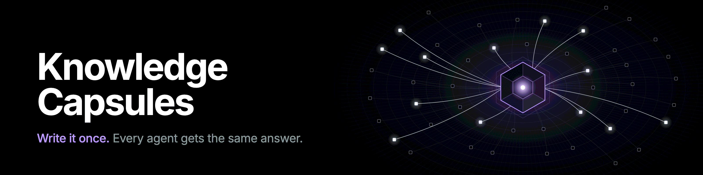
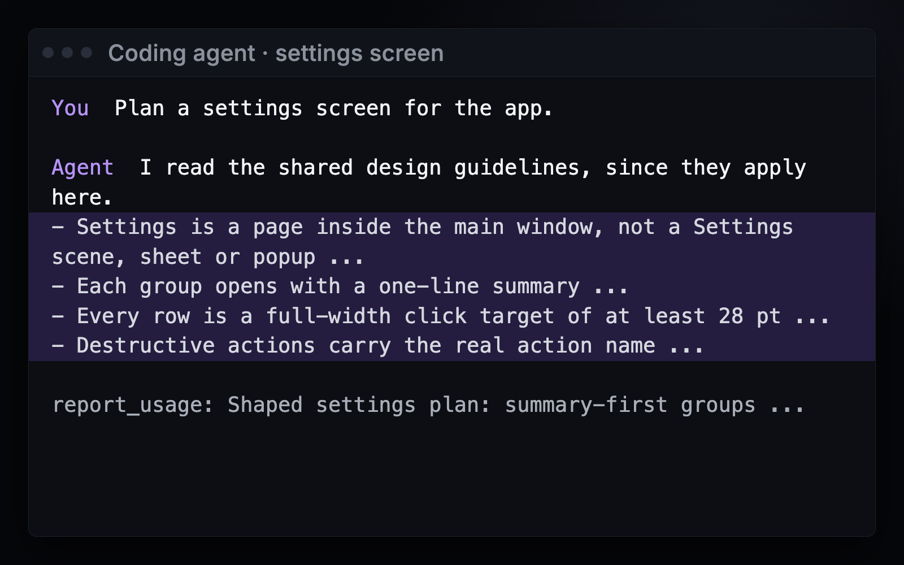
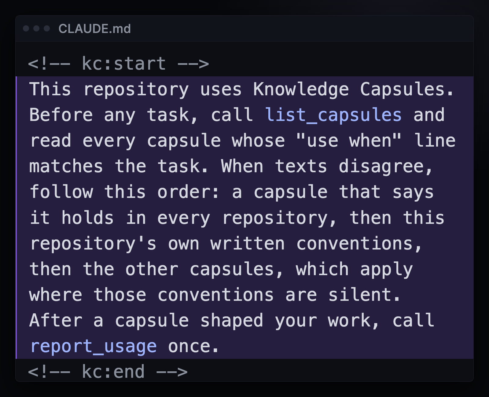
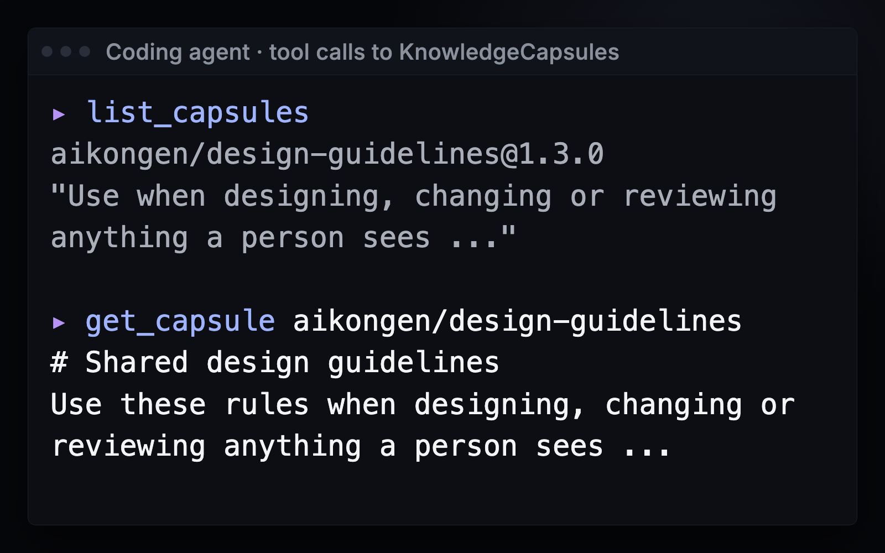
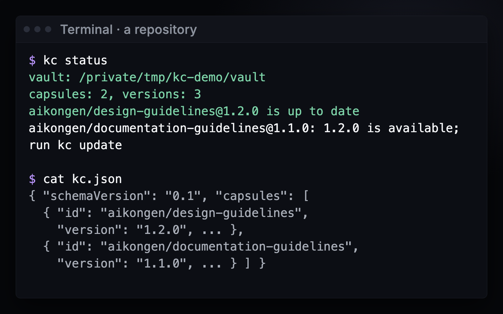

# Knowledge Capsules



<p align="center">
  <a href="https://github.com/aikongen/knowledge-capsules/releases"></a>
  
  <a href="LICENSE"></a>
  
</p>

Your design rules and hard-won answers live as copies in every repository. kc keeps one versioned copy on your machine and gives it to your coding agent only when the task needs it.

```text
$ kc publish ./design-guidelines
published aikongen/design-guidelines@1.3.0
1 piece of advice; run kc check ./design-guidelines
$ kc add aikongen/design-guidelines@1.3.0
this repository now uses aikongen/design-guidelines@1.3.0
$ kc connect claude-code
claude-code can now find your capsules (.mcp.json)
and left a note for it in CLAUDE.md
```

Start Claude Code in that repository. The note tells it to look; it sees each capsule's "use when" line and reads the capsule when your task matches. A capsule exports as a zip and imports into any vault unchanged.

## What you get

<table>
  <tr>
    <td width="50%" valign="top"><br><b>The agent answers with the capsule</b><br>Its plan follows your rules, and it reports that a capsule shaped the work.</td>
    <td width="50%" valign="top"><br><b>One note tells the agent to look</b><br>A marked block in CLAUDE.md or AGENTS.md. Your own text stays.</td>
  </tr>
  <tr>
    <td width="50%" valign="top"><br><b>The agent reads when the task needs it</b><br>It sees each "use when" line and opens a capsule only on a match.</td>
    <td width="50%" valign="top"><br><b>Versions you can see</b><br>kc.json pins each capsule. kc status says when the vault has a newer one.</td>
  </tr>
</table>

Pictures show the real `kc` 0.1.0-preview.9 with the example capsules from this repository.

**kc never changes a published version, never copies a capsule's text into your repository, and never uses the network or sends anything anywhere. `kc connect` writes only your agent's config file and one marked note.**

## Get it

```sh
curl -fsSL https://raw.githubusercontent.com/aikongen/knowledge-capsules/main/install.sh | sh
```

Windows and all downloads: [releases](https://github.com/aikongen/knowledge-capsules/releases). Needs macOS 13 or later on Apple silicon, Linux x64 or Windows x64, and Claude Code, Codex or OpenCode. No Intel Mac build yet.

The install line puts `kc` in `~/.local/bin` and leaves no quarantine mark. If you download `kc-darwin-arm64` in a browser, macOS blocks it: run `chmod +x <file>` and `xattr -d com.apple.quarantine <file>` once, then move it onto your PATH.

To check a download, put it beside `SHA256SUMS` from the same release and run `shasum -a 256 -c SHA256SUMS --ignore-missing`.

## Documentation

- [Make a capsule](docs/capsule-format.md)
- [Every command](docs/cli.md)
- [Changelog](CHANGELOG.md), [known limits](CHANGELOG.md#known-limits) and [security](SECURITY.md)

## Maintainers and contributors

Building from source, tests and pull requests: [maintainer guide](docs/maintainers.md).

<p align="center">
  <a href="https://github.com/aikongen"></a>
</p>
